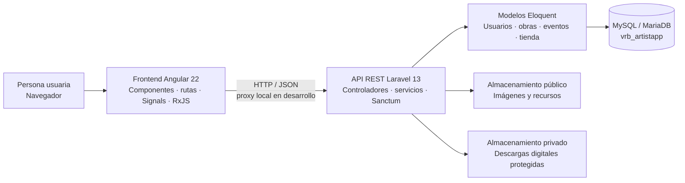

<div align="center">

# ArtistApp

### Un espacio digital para crear, compartir y encontrarse a través del arte.

Una comunidad para artistas independientes, organizadores y amantes del arte. Descubre obras, conecta con sus creadores, participa en eventos y explora una tienda de piezas originales.


</div>

---

## Sobre el proyecto

ArtistApp es una plataforma web que reúne en un mismo lugar una red social creativa, una agenda de eventos y una tienda para artistas. La aplicación se ha reconstruido con un frontend en Angular y una API REST en Laravel, conservando compatibilidad con el esquema histórico de MySQL.

El objetivo es ofrecer a cada persona un espacio donde mostrar su trabajo, descubrir nuevos creadores y participar en una comunidad artística.

## Qué puedes hacer

| Área | Funcionalidades |
| --- | --- |
| **Descubrir** | Explorar obras, artistas y eventos; buscar, filtrar y recorrer resultados paginados. |
| **Comunidad** | Consultar perfiles, biografías, seguidores y seguidos; seguir cuentas y guardar obras favoritas. |
| **Publicaciones** | Compartir y gestionar obras, indicar que te gustan y conversar en los comentarios. |
| **Eventos** | Crear eventos según el tipo de cuenta, gestionar solicitudes y conversar en el chat grupal del evento. |
| **Mensajes** | Mantener conversaciones directas con otros usuarios desde una bandeja unificada. |
| **Tienda** | Publicar productos físicos o digitales, añadirlos a la cesta, comprar y consultar pedidos. |
| **Avisos** | Recibir notificaciones de actividad y comunicaciones importantes de administración. |
| **Administración** | Gestionar recursos de la plataforma desde un panel protegido. |
| **Cuenta** | Crear una cuenta, iniciar sesión, actualizar el perfil y gestionar la contraseña. |

### Tipos de cuenta

| Tipo | Permisos principales |
| --- | --- |
| Administrador | Panel de administración y gestión de la plataforma. |
| Artista | Publicar obras y gestionar productos para la tienda. |
| Organizador de eventos | Crear eventos y gestionar productos para la tienda. |
| Amante del arte | Descubrir, seguir artistas, comprar y participar en eventos. |

Los IDs históricos se mantienen: `1` administrador, `3` organizador, `5` artista y `7` amante del arte.

## Tecnologías y arquitectura

| Capa | Tecnología | Responsabilidad |
| --- | --- | --- |
| Frontend | Angular 22, TypeScript, Signals y RxJS | Interfaz, navegación, formularios y estado reactivo. |
| Backend | Laravel 13, PHP 8.3 y Sanctum | API JSON, autenticación, permisos y lógica de negocio. |
| Datos | MySQL / MariaDB compatible | Persistencia basada en el esquema de ArtistApp y migraciones Laravel. |
| Desarrollo local | Proxy de Angular | Dirige `/api` y `/storage` hacia Laravel durante el desarrollo. |

```text
Navegador
   │
   ▼
Angular · http://localhost:4200
   │  /api y /storage mediante proxy
   ▼
Laravel · http://127.0.0.1:8000
   │
   ├── MySQL · vrb_artistapp
   ├── Almacenamiento público · imágenes y archivos visibles
   └── Almacenamiento privado · descargas digitales protegidas
```

## Cómo está construido

ArtistApp separa la interfaz, la lógica de negocio y los datos. Angular presenta la aplicación y se comunica con Laravel mediante peticiones HTTP con respuestas JSON. Laravel valida cada petición, aplica las reglas de acceso y coordina los modelos, la base de datos y los archivos.



### Interfaz Angular

La aplicación está organizada en páginas para cada área (descubrimiento, perfiles, eventos, tienda y administración) y componentes compartidos para elementos como la navegación, los modales y el chat. Los servicios del núcleo centralizan las llamadas a la API, la autenticación y el estado compartido. Angular Signals mantiene reactivos los datos de la sesión, la cesta y las notificaciones; RxJS gestiona los flujos asíncronos.

### API Laravel

Las rutas de `api.php` dirigen las peticiones a controladores REST. Estos aplican validaciones y permisos, y usan modelos Eloquent y servicios para acceder a los datos o ejecutar operaciones compartidas. Laravel Sanctum protege las operaciones que requieren una sesión autenticada. Las migraciones y seeders complementan el esquema histórico y preparan los catálogos.

### Datos, imágenes y comunicación local

MySQL o MariaDB conserva las cuentas, publicaciones, relaciones, eventos, pedidos y demás información. Las imágenes se sirven desde almacenamiento público; los archivos digitales comprados se mantienen en almacenamiento privado para controlar su descarga. En desarrollo, el proxy de Angular reenvía `/api` y `/storage` al servidor Laravel, que se ejecuta por separado.

## Puesta en marcha

### Requisitos

- Node.js 24.15 o superior y npm.
- PHP 8.3 o superior con PDO MySQL, Mbstring, OpenSSL, Fileinfo, Tokenizer, XML y Ctype.
- Composer 2.
- MySQL 8 o MariaDB compatible.

### 1. Instalar y configurar el backend

Desde PowerShell, en la raíz del repositorio:

```powershell
cd .\backend
Copy-Item .env.example .env
composer install
```

Edita `backend/.env` y configura la conexión MySQL. Crea o selecciona la base `vrb_artistapp`.

Para usar el volcado histórico, importa `BaseDeDatos/vrb_artistapp.sql`. Para una demo aislada, importa `BaseDeDatos/vrb_artistapp_muestra.sql` en una base vacía. En el SQL de muestra, las cuentas usan la contraseña `Usuario123`; los nombres y textos de muestra son ficticios.

Después, desde `backend/`, ejecuta:

```powershell
php artisan key:generate
php artisan migrate --seed
php artisan storage:link
php artisan serve --host=127.0.0.1 --port=8000
```

Para crear o completar únicamente las categorías y tipos de usuario:

```powershell
php artisan artistapp:setup-catalogs
```

El comando también aplica migraciones pendientes y se puede volver a ejecutar sin duplicar esos catálogos. **No uses `php artisan migrate:fresh`** sobre una base cuyos datos quieras conservar, porque elimina sus tablas.

Si PowerShell no reconoce `php` o `composer`, instala esas herramientas o agrega sus carpetas al `PATH` (por ejemplo, desde Laragon).

### 2. Instalar y arrancar el frontend

En una segunda terminal, desde la raíz del repositorio:

```powershell
cd .\frontend
npm install
npm start
```

`npm start` ejecuta Angular con el proxy de desarrollo configurado. Abre [http://localhost:4200](http://localhost:4200). Mantén el backend activo en la otra terminal.

Para compilar la aplicación:

```powershell
npm run build
```

### Restablecimiento de contraseña

En desarrollo, Laravel registra los correos de recuperación en `backend/storage/logs/laravel.log`. Configura SMTP en `backend/.env` para enviar correos reales.

## Datos de demostración

El SQL de muestra conserva IDs, relaciones y rutas multimedia para poder recorrer la aplicación; las cuentas, eventos y textos de ejemplo son inventados. Las cuentas incluidas usan `Usuario123` como contraseña. No importes el SQL de muestra sobre una base que contenga datos que quieras conservar.

## Autora

**Vanesa Ribera Bautista** · Proyecto final de ciclo de Desarrollo de Aplicaciones Web.
